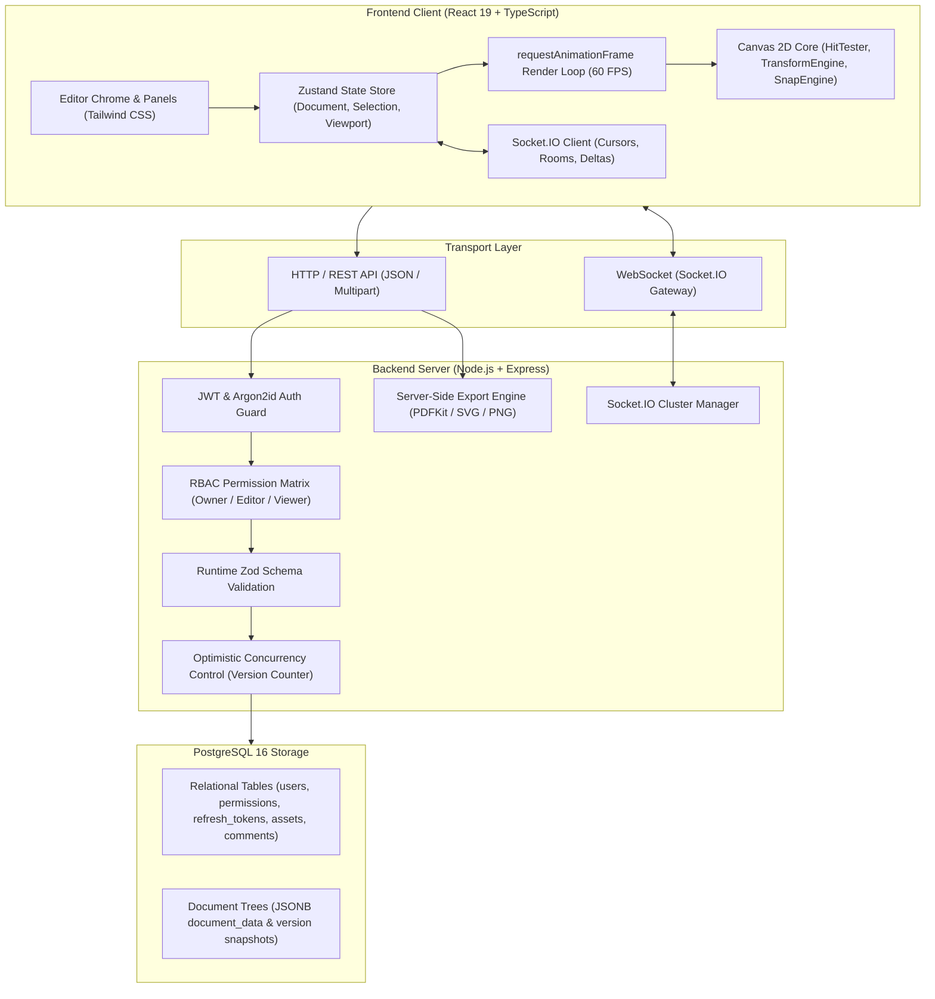
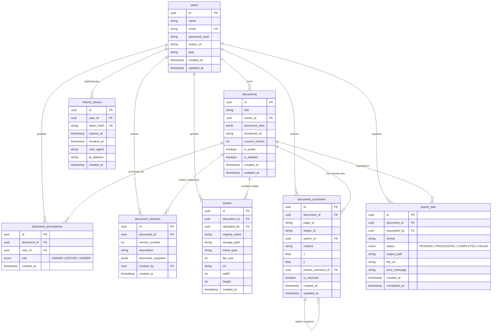

# VECTORLY — Collaborative In-Browser Vector Design Platform (Mini Figma)

> **A professional, high-performance vector graphics editor and collaborative design platform built from scratch natively for the browser. Featuring a zero-dependency HTML5 Canvas 2D rendering engine with $3 \times 3$ affine transformation matrices, React 19, TypeScript strict mode, and backed by a production Node.js, PostgreSQL (relational + JSONB document trees), Prisma ORM, and Socket.IO real-time collaboration backend.**

---

## Table of Contents

1. [Project Overview & Core Philosophy](#1-project-overview--core-philosophy)
2. [Standardized Feature Status Matrix](#2-standardized-feature-status-matrix)
3. [System Architecture & Design Diagrams](#3-system-architecture--design-diagrams)
   - [High-Level System Topology](#high-level-system-topology)
   - [Database Entity-Relationship Diagram (ERD)](#database-entity-relationship-diagram-erd)
   - [Hierarchical Document Tree Model](#hierarchical-document-tree-model)
4. [Architectural Justification: Canvas 2D Engine](#4-architectural-justification-canvas-2d-engine)
   - [Technology Comparison: Canvas 2D vs. SVG DOM vs. WebGL](#technology-comparison-canvas-2d-vs-svg-dom-vs-webgl)
   - [Linear Algebra & Coordinate Spaces](#linear-algebra--coordinate-spaces)
   - [Render Loop Decoupling & 60fps Target](#render-loop-decoupling--60fps-target)
5. [Complete API Route Inventory](#5-complete-api-route-inventory)
6. [Local Setup & Step-by-Step Execution](#6-local-setup--step-by-step-execution)
   - [Prerequisites](#prerequisites)
   - [Option A: Automated Docker Compose (One-Command)](#option-a-automated-docker-compose-one-command)
   - [Option B: Local Development Setup](#option-b-local-development-setup)
   - [Database Seeding & Test Credentials](#database-seeding--test-credentials)
7. [Automated Testing Suite (67 Passing Tests)](#7-automated-testing-suite-67-passing-tests)
8. [Documented Limitations & Scalability Roadmap](#8-documented-limitations--scalability-roadmap)

---

## 1. Project Overview & Core Philosophy

VECTORLY is an engineering-first implementation of a browser-based vector design suite inspired by Figma. Built to satisfy both **Frontend** and **Backend** intern requirements without relying on third-party canvas abstraction engines (e.g., Fabric.js, Konva, Paper.js, or Excalidraw) or Backend-as-a-Service (BaaS) wrappers (e.g., Firebase, Supabase).

### Core Engineering Tenets:
- **Scratch-Built Canvas Engine:** Every selection boundary, 8-handle transformation anchor, rotation gizmo, hit-test raycast, and rendering pass is calculated from pure mathematics in TypeScript.
- **Affine Transformation Mathematics:** Every canvas node maintains an immutable $3 \times 3$ homogeneous transformation matrix supporting composite translation, non-uniform scaling, and rotation.
- **Hybrid Relational + JSONB Storage:** Relational PostgreSQL entities manage users, permissions, sessions, comments, and versions, while the variable hierarchical document tree is stored in binary JSON (`JSONB`) with runtime Zod validation.
- **Optimistic Concurrency Control:** Client auto-saving features debounced state pushes backed by version counter checks on the backend (`PATCH /api/documents/:id/sync`), rejecting stale concurrent modifications with HTTP `409 Conflict`.
- **Real-Time Collaboration:** Native WebSocket communication using Socket.IO, complete with document room isolation, peer presence indicators, and live cursor tracking.

---

## 2. Standardized Feature Status Matrix

The following matrix formally audits all criteria across **Level 1 (Core Foundation)**, **Level 2 (Production Editor & Backend)**, and **Level 3 (Stretch Goals)**:

| Level | Track | Requirement / Feature | Status | Implementation Details & References |
| :--- | :--- | :--- | :---: | :--- |
| **L1** | Frontend | **Basic Shapes** (Rect, Ellipse, Line, Text) | `COMPLETED` | Native path generators in [`src/editor/rendering/ShapeRenderer.ts`](file:///c:/Users/Askari%20%20Hasni/Desktop/student%20task/src/editor/rendering/ShapeRenderer.ts). |
| **L1** | Frontend | **Single & Additive Selection** | `COMPLETED` | Pointer hit-testing + Shift-click additive toggle in [`HitTester.ts`](file:///c:/Users/Askari%20%20Hasni/Desktop/student%20task/src/editor/selection/HitTester.ts). |
| **L1** | Frontend | **Marquee Drag Selection** | `COMPLETED` | Dynamic bounding box intersection in [`CanvasViewport.tsx`](file:///c:/Users/Askari%20%20Hasni/Desktop/student%20task/src/pages/editor/CanvasViewport.tsx). |
| **L1** | Frontend | **8-Handle Scaling & Rotation** | `COMPLETED` | Affine transformation handles in [`TransformEngine.ts`](file:///c:/Users/Askari%20%20Hasni/Desktop/student%20task/src/editor/transforms/TransformEngine.ts). |
| **L1** | Frontend | **Viewport Zoom & Pan** | `COMPLETED` | Cursor-centered zoom (`Ctrl + Wheel`) and infinite pan (`Space + Drag`) in [`ViewportController.ts`](file:///c:/Users/Askari%20%20Hasni/Desktop/student%20task/src/editor/viewport/ViewportController.ts). |
| **L1** | Frontend | **Undo / Redo History Stack** | `COMPLETED` | Atomic state stack coalescing drag events in [`HistoryManager.ts`](file:///c:/Users/Askari%20%20Hasni/Desktop/student%20task/src/editor/history/HistoryManager.ts). |
| **L1** | Frontend | **Keyboard Shortcuts & Basics** | `COMPLETED` | Shortcuts (`Delete`, `Ctrl+C`, `Ctrl+V`, `Ctrl+Z`, `Ctrl+Y`) in [`useKeyboardShortcuts.ts`](file:///c:/Users/Askari%20%20Hasni/Desktop/student%20task/src/editor/events/useKeyboardShortcuts.ts). |
| **L1** | Frontend | **Auth & Shell UI Dashboard** | `COMPLETED` | Responsive login, registration, and file management in [`DashboardPage.tsx`](file:///c:/Users/Askari%20%20Hasni/Desktop/student%20task/src/pages/dashboard/DashboardPage.tsx). |
| **L1** | Backend | **PostgreSQL Schema & Migrations** | `COMPLETED` | Prisma schema with automated migrations in [`server/prisma/schema.prisma`](file:///c:/Users/Askari%20%20Hasni/Desktop/student%20task/server/prisma/schema.prisma). |
| **L1** | Backend | **Authentication & Password Hashing** | `COMPLETED` | Argon2id hashing, dual JWT (Access + Refresh) in [`auth.service.ts`](file:///c:/Users/Askari%20%20Hasni/Desktop/student%20task/server/src/modules/auth/auth.service.ts). |
| **L1** | Backend | **Document CRUD Endpoints** | `COMPLETED` | RESTful `POST/GET/PATCH/DELETE /api/documents` with soft-deletion support. |
| **L1** | Backend | **Strict Document Schema Validation**| `COMPLETED` | Strict Zod validation over Document Tree in [`document.schemas.ts`](file:///c:/Users/Askari%20%20Hasni/Desktop/student%20task/server/src/modules/documents/document.schemas.ts). |
| **L1** | Backend | **Interactive API Documentation** | `COMPLETED` | OpenAPI / Swagger UI live at `http://localhost:5000/api/docs`. |
| **L2** | Frontend | **Vector Pen Tool & Bézier Paths** | `COMPLETED` | Interactive anchor points, Bézier rendering, and path closure in [`Bezier.ts`](file:///c:/Users/Askari%20%20Hasni/Desktop/student%20task/src/editor/math/Bezier.ts). |
| **L2** | Frontend | **Hierarchical Layers Panel** | `COMPLETED` | Drag-and-drop reordering, lock/visibility toggles, renaming in [`LeftSidebar.tsx`](file:///c:/Users/Askari%20%20Hasni/Desktop/student%20task/src/pages/editor/LeftSidebar.tsx). |
| **L2** | Frontend | **Properties Inspector Panel** | `COMPLETED` | Live inputs for fill, stroke, opacity, corner radius, drop shadow in [`RightSidebar.tsx`](file:///c:/Users/Askari%20%20Hasni/Desktop/student%20task/src/pages/editor/RightSidebar.tsx). |
| **L2** | Frontend | **Smart Alignment & Snapping** | `COMPLETED` | Real-time edge, center, and spacing snapping with visual guides in [`SnapEngine.ts`](file:///c:/Users/Askari%20%20Hasni/Desktop/student%20task/src/editor/transforms/SnapEngine.ts). |
| **L2** | Frontend | **Persistence UI & Versioning** | `COMPLETED` | Silent debounced auto-save, JSON import/export, and modal rollback in [`VersionHistoryModal.tsx`](file:///c:/Users/Askari%20%20Hasni/Desktop/student%20task/src/pages/editor/VersionHistoryModal.tsx). |
| **L2** | Backend | **Incremental Auto-Save & OCC** | `COMPLETED` | `PATCH /api/documents/:id/sync` using version counters to prevent lost updates (409 Conflict). |
| **L2** | Backend | **Snapshots & Version History** | `COMPLETED` | Snapshot creation and one-click rollback in [`versions.controller.ts`](file:///c:/Users/Askari%20%20Hasni/Desktop/student%20task/server/src/modules/versions/versions.controller.ts). |
| **L2** | Backend | **Media Upload Pipeline** | `COMPLETED` | Image & SVG upload with MIME/size validation in [`assets.controller.ts`](file:///c:/Users/Askari%20%20Hasni/Desktop/student%20task/server/src/modules/assets/assets.controller.ts). |
| **L2** | Backend | **Role-Based Access Control (RBAC)** | `COMPLETED` | `OWNER`, `EDITOR`, `VIEWER` permission matrix enforced by [`rbac.middleware.ts`](file:///c:/Users/Askari%20%20Hasni/Desktop/student%20task/server/src/middleware/rbac.middleware.ts). |
| **L2** | Backend | **Security Hardening** | `COMPLETED` | Helmet headers, rate limiting (1000 req/15min), SVG script sanitization against XSS. |
| **L3** | Full-Stack | **Real-Time Collaboration** (Goal 1)| `COMPLETED` | Socket.IO room presence, peer cursors, delta broadcast in [`collaboration.gateway.ts`](file:///c:/Users/Askari%20%20Hasni/Desktop/student%20task/server/src/modules/collaboration/collaboration.gateway.ts). |
| **L3** | Full-Stack | **Canvas Contextual Comments** (Goal 2)| `COMPLETED` | Threaded canvas coordinate pins `(x, y)` with reply & resolve states in [`comments.controller.ts`](file:///c:/Users/Askari%20%20Hasni/Desktop/student%20task/server/src/modules/comments/comments.controller.ts). |
| **L3** | Full-Stack | **Server-Side Export Engine** (Goal 3)| `COMPLETED` | Vector SVG generation, PDFKit printable PDF, and PNG export in [`exports.service.ts`](file:///c:/Users/Askari%20%20Hasni/Desktop/student%20task/server/src/modules/exports/exports.service.ts). |
| **Bonus**| Full-Stack | **Gemini AI Design Copilot** | `COMPLETED` | Real Gemini 2.5 Flash / 1.5 Flash assistant with client fallback in [`GeminiChatDrawer.tsx`](file:///c:/Users/Askari%20%20Hasni/Desktop/student%20task/src/components/ai/GeminiChatDrawer.tsx). |
| **Bonus**| DevOps | **Containerized Orchestration** | `COMPLETED` | Multi-stage Dockerfile + `docker-compose.yml` for PostgreSQL, Backend, and Nginx Frontend. |

---

## 3. System Architecture & Design Diagrams

### High-Level System Topology



---

### Database Entity-Relationship Diagram (ERD)



---

### Hierarchical Document Tree Model

The unified data model adheres strictly to the **Document $\rightarrow$ Pages $\rightarrow$ Frames $\rightarrow$ Shapes** hierarchy:

```json
{
  "id": "doc_crypto_wallet_001",
  "name": "Crypto Wallet Mobile App",
  "version": 1,
  "pages": [
    {
      "id": "page_1",
      "name": "Mobile Dashboard",
      "nodes": [
        {
          "id": "frame_app_screen",
          "type": "frame",
          "name": "Mobile Screen (iPhone 16)",
          "visible": true,
          "locked": false,
          "opacity": 1,
          "rotation": 0,
          "x": 100,
          "y": 100,
          "width": 380,
          "height": 720,
          "fill": "#0F172A",
          "stroke": "#334155",
          "strokeWidth": 1,
          "cornerRadius": 32,
          "clipContent": true,
          "childrenIds": ["rect_balance_card", "text_portfolio_val"],
          "transformMatrix": [1, 0, 100, 0, 1, 100, 0, 0, 1]
        },
        {
          "id": "rect_balance_card",
          "type": "rectangle",
          "name": "Balance Card",
          "parentId": "frame_app_screen",
          "visible": true,
          "locked": false,
          "opacity": 1,
          "rotation": 0,
          "x": 124,
          "y": 160,
          "width": 332,
          "height": 160,
          "fill": "#1E293B",
          "stroke": "#475569",
          "strokeWidth": 1,
          "cornerRadius": 20,
          "transformMatrix": [1, 0, 124, 0, 1, 160, 0, 0, 1]
        }
      ]
    }
  ]
}
```

---

## 4. Architectural Justification: Canvas 2D Engine

### Technology Comparison: Canvas 2D vs. SVG DOM vs. WebGL

Choosing the rendering architecture for a browser-based design tool requires balancing vector fidelity, memory overhead, frame rate consistency, and implementation velocity:

| Evaluation Metric | HTML5 Canvas 2D (VECTORLY Choice) | SVG DOM (e.g. React-SVG) | WebGL / WebGPU |
| :--- | :--- | :--- | :--- |
| **Rendering Throughput (500+ Shapes)** | **Steady 60 FPS:** Direct pixel rasterization into a backing buffer without DOM tree thrashing. | **Degrades severely ($<20\text{ FPS}$):** Each shape is a live DOM node triggering layout passes and garbage collection. | **Extremely high ($120+\text{ FPS}$):** GPU batched instanced drawing. |
| **Hit-Testing & Selection Math** | **Explicit Math Control:** Analytical raycasting against affine bounding boxes and Bézier curves. | **Browser Built-in:** `elementFromPoint()` is easy but breaks on rotated transformed groups. | **Complex:** Requires GPU picking buffers (color-ID indexing) or duplicating CPU math. |
| **Memory Footprint** | **Minimal:** Single HTMLCanvas element in the DOM tree regardless of shape count. | **Linear Overhead:** High memory usage (10,000 nodes = 10,000 DOM elements + style listeners). | **Moderate:** GPU VRAM allocation for vertex buffers and textures. |
| **Vector Geometry Fidelity** | **Pixel-Perfect:** Sub-pixel path rendering via Canvas path APIs with full anti-aliasing. | **Native Vector:** Infinite sharpness at any zoom level. | **Non-Trivial:** Vector curve antialiasing requires specialized shaders (Loop-Blinn / stencil-and-cover). |
| **Implementation Complexity** | **Balanced & Predictable:** Clean separation of state, math, and rendering passes. | **Low initial, high long-term:** DOM events become unmaintainable under complex transforms. | **High:** Custom shader authoring, pipeline management, and font atlas rendering. |

**Architectural Decision:** HTML5 Canvas 2D provides the optimal architectural balance. It guarantees a deterministic 60fps render loop under heavy loads ($1000+$ shapes) while avoiding the DOM tree bloat of SVG and the immense shader complexity of custom WebGL vector rasterization.

---

### Linear Algebra & Coordinate Spaces

All spatial manipulations use standard 2D homogeneous affine transformation matrices:

$$\mathbf{M} = \begin{bmatrix} a & c & e \\ b & d & f \\ 0 & 0 & 1 \end{bmatrix}$$

Where:
- $a, d$: Scaling factors ($s_x, s_y$)
- $b, c$: Shear / rotation components ($\sin\theta, -\sin\theta$)
- $e, f$: Translation offsets ($t_x, t_y$)

#### Clean Coordinate Space Separation:
1. **Screen Space (Viewport Pixels):** Raw mouse events from `event.clientX`, `event.clientY` relative to the browser window.
2. **World / Canvas Space:** Infinite canvas coordinates independent of zoom or pan:
   $$\begin{bmatrix} x_{\text{world}} \\ y_{\text{world}} \end{bmatrix} = \frac{1}{\text{zoom}} \left( \begin{bmatrix} x_{\text{screen}} \\ y_{\text{screen}} \end{bmatrix} - \begin{bmatrix} t_x \\ t_y \end{bmatrix} \right)$$
3. **Local Object Space:** Coordinates relative to an object's center or top-left, enabling scale/rotation around its natural geometric anchor.

---

### Render Loop Decoupling & 60fps Target

To avoid high-frequency pointer move events triggering React state renders, the rendering pipeline is decoupled:
- **High-Frequency Events:** `pointermove` updates mutable refs (`dragOffset`, `currentPointer`).
- **Render Engine:** A centralized `requestAnimationFrame` loop redraws the canvas only when dirty flags are set:
  ```
  requestAnimationFrame(renderPass)
    ├── 1. Clear Screen & Draw Infinite Dot Grid (GridRenderer)
    ├── 2. Set Canvas Transform Matrix [zoom, 0, tx, 0, zoom, ty]
    ├── 3. Render Hierarchy: Frames -> Rectangles -> Ellipses -> Paths -> Text (ShapeRenderer)
    ├── 4. Render Active Overlay: Selection Bounding Box, 8 Handles, Rotation Gizmo (OverlayRenderer)
    ├── 5. Render Dynamic Alignment Guides (SnapEngine)
    └── 6. Render Collaborative Peer Cursors
  ```

---

## 5. Complete API Route Inventory

The backend exposes a fully typed, rate-limited, and RBAC-governed REST API documented interactively via Swagger (`http://localhost:5000/api/docs`):

### 1. Authentication & Session Management
- `POST /api/auth/register` — Create new user account with Argon2id password hash, auto-generate starter projects.
- `POST /api/auth/login` — Authenticate credentials, issue access JWT + HTTP-only rotating refresh token.
- `POST /api/auth/refresh` — Issue fresh access token using validated refresh token cookie.
- `POST /api/auth/logout` — Revoke active refresh token session in database.
- `GET /api/auth/me` — Retrieve authenticated user profile, plan, and permissions.

### 2. Document Lifecycle & CRUD
- `GET /api/documents` — List user documents with search, sorting, and pagination (`?filter=recent|all&limit=50`).
- `POST /api/documents` — Create a new blank design document with default canvas page.
- `GET /api/documents/:id` — Retrieve full document tree with verification of user RBAC permissions.
- `PATCH /api/documents/:id` — Rename document title or update metadata.
- `DELETE /api/documents/:id` — Soft-delete document (`is_deleted: true`).
- `PATCH /api/documents/:id/sync` — **Optimistic Locking Sync:** Atomically updates document JSONB data if `expectedVersion == currentVersion`. Returns `409 Conflict` on concurrent collisions.

### 3. Version History & Snapshots
- `GET /api/documents/:id/versions` — List historical milestone snapshots with timestamps and authors.
- `POST /api/documents/:id/versions` — Create an immutable manual snapshot with description.
- `POST /api/documents/:id/versions/:versionNumber/rollback` — Restore document canvas state to a historical version.

### 4. Role-Based Access Control (RBAC) & Sharing
- `GET /api/documents/:id/permissions` — Retrieve team member permission matrix.
- `POST /api/documents/:id/permissions` — Invite collaborator with role (`EDITOR` or `VIEWER`).
- `PATCH /api/documents/:id/permissions/:userId` — Update collaborator role.
- `DELETE /api/documents/:id/permissions/:userId` — Revoke collaborator access.

### 5. Media Upload Pipeline
- `POST /api/assets/upload` — Multipart upload for PNG, JPG, WebP, and SVG images with strict MIME validation.
- `GET /api/assets/:id` — Stream asset binary with cache headers.

### 6. Canvas Contextual Comments
- `GET /api/documents/:id/comments` — Fetch threaded comments with canvas coordinates `(x, y)` and page IDs.
- `POST /api/documents/:id/comments` — Pin new comment thread or post reply to existing comment.
- `PATCH /api/documents/:id/comments/:commentId` — Resolve or reopen comment thread.
- `DELETE /api/documents/:id/comments/:commentId` — Delete comment.

### 7. Asynchronous & Server-Side Exports
- `POST /api/documents/:id/export` — Queue server-side export (Vector SVG, PDFKit printable PDF, JSON, PNG).
- `GET /api/exports/:jobId` — Poll status of export task and retrieve signed download URL.

### 8. Gemini AI Design Generator
- `POST /api/ai/generate` — Synthesize vector UI components from natural language design prompts.
- `GET /api/ai/status` — Check status of Gemini models and server API key.
- `POST /api/ai/set-key` — Configure Google Gemini API key.

### 9. Infrastructure & Health
- `GET /healthz` — Service health check verifying PostgreSQL connection, uptime, and memory usage.

---

## 6. Local Setup & Step-by-Step Execution

### Prerequisites
- **Node.js** >= `18.0.0` (LTS recommended)
- **npm** >= `9.0.0`
- **PostgreSQL** >= `16` (or Docker Desktop)

---

### Option A: Automated Docker Compose (One-Command)

The repository provides a complete multi-container Docker configuration running PostgreSQL 16, the Node.js API backend, and the Nginx frontend client:

```bash
# 1. Clone repository
git clone https://github.com/your-username/vectorly.git
cd vectorly

# 2. Build and launch all services in background
docker compose up -d --build

# 3. Check container health
docker compose ps
```

- **Frontend Application:** `http://localhost:5173`
- **Backend API & WebSockets:** `http://localhost:5000`
- **Swagger Documentation:** `http://localhost:5000/api/docs`
- **PostgreSQL Database:** `localhost:5432`

To shut down:
```bash
docker compose down
```

---

### Option B: Local Development Setup

#### 1. Setup Environment Variables
```bash
# In project root
cp .env.example server/.env
```

#### 2. Install Dependencies
```bash
# Install root (frontend) dependencies
npm install

# Install server (backend) dependencies
cd server
npm install
cd ..
```

#### 3. Database Initialization & Seeding
Ensure PostgreSQL is running locally on port 5432 with database `vectorly_db`:
```bash
cd server
npx prisma db push
npm run prisma:seed
cd ..
```

#### 4. Run Development Servers
Open two terminal windows:

```bash
# Terminal 1: Start Backend API & Collaboration Server (Port 5000)
npm run server:dev

# Terminal 2: Start Frontend Application (Port 5173 with Vite proxy)
npm run dev
```

Visit `http://localhost:5173` in Google Chrome, Brave, or Edge.

---

### Database Seeding & Test Credentials

The database seeder (`npm run server:seed`) automatically generates test accounts and three rich sample documents:

| Credential | Value |
| :--- | :--- |
| **Email** | `designer@minifigma.io` |
| **Password** | `password123` |
| **Pre-loaded Documents** | 1. Crypto Wallet Mobile App (Mobile Frame, Inputs, Gradients)<br>2. Design System Hero & Components (Typography, Swatches)<br>3. Brand Styleguide & Icons (Vectors, Badges, Metrics) |

---

## 7. Automated Testing Suite (67 Passing Tests)

The repository maintains **67 unit and integration tests** verifying core algorithms and security policies:

```bash
# Run complete test suite across frontend and backend
npm run test:all
```

### Breakdown of Test Coverage:

#### Frontend Unit & Math Tests (`npm test` — 37 Passing):
- [`src/tests/math.test.ts`](file:///c:/Users/Askari%20%20Hasni/Desktop/student%20task/src/tests/math.test.ts): 16 tests verifying 2D vector arithmetic, affine transformation matrix multiplication, inversion, and coordinate projections.
- [`src/tests/transforms.test.ts`](file:///c:/Users/Askari%20%20Hasni/Desktop/student%20task/src/tests/transforms.test.ts): 11 tests verifying 8-handle resizing, aspect ratio locks, rotation math, and snap guides.
- [`src/tests/document.test.ts`](file:///c:/Users/Askari%20%20Hasni/Desktop/student%20task/src/tests/document.test.ts): 4 tests verifying node creation, tree immutability, and normalization.
- [`src/tests/integration.test.ts`](file:///c:/Users/Askari%20%20Hasni/Desktop/student%20task/src/tests/integration.test.ts): 6 tests verifying client auth state persistence, token storage, and session recovery.

#### Backend Integration Tests (`npm run server:test` — 30 Passing):
- [`server/tests/integration/auth.test.ts`](file:///c:/Users/Askari%20%20Hasni/Desktop/student%20task/server/tests/integration/auth.test.ts): 8 tests verifying registration, Argon2id validation, token rotation, and invalid credential rejections.
- [`server/tests/integration/documents.test.ts`](file:///c:/Users/Askari%20%20Hasni/Desktop/student%20task/server/tests/integration/documents.test.ts): 7 tests verifying CRUD operations, pagination, search filters, and soft deletions.
- [`server/tests/integration/permissions.test.ts`](file:///c:/Users/Askari%20%20Hasni/Desktop/student%20task/server/tests/integration/permissions.test.ts): 6 tests verifying RBAC access boundaries (`OWNER` vs. `VIEWER` mutation rejection).
- [`server/tests/integration/sync.test.ts`](file:///c:/Users/Askari%20%20Hasni/Desktop/student%20task/server/tests/integration/sync.test.ts): 4 tests verifying optimistic concurrency control and `409 Conflict` detection on stale versions.
- [`server/tests/integration/assets.test.ts`](file:///c:/Users/Askari%20%20Hasni/Desktop/student%20task/server/tests/integration/assets.test.ts): 3 tests verifying file upload type restrictions and asset retrieval.
- [`server/tests/integration/health.test.ts`](file:///c:/Users/Askari%20%20Hasni/Desktop/student%20task/server/tests/integration/health.test.ts): 2 tests verifying `/healthz` uptime and database status checks.

---

## 8. Documented Limitations & Scalability Roadmap

In accordance with Section 6 & 8 of the intern assignment specification, the following architectural trade-offs and future roadmaps are transparently documented:

### 1. Constructive Solid Geometry (CSG) / Boolean Operations
- **Current Status:** Basic vector path manipulation and cubic Bézier anchor edits are supported via the custom Pen Tool. Boolean operations (Union, Subtract, Intersect, Exclude) on overlapping closed paths are currently stubbed.
- **Scalability Roadmap:** Integrate the Clipper.js integer polygon clipping library or Paper.js boolean kernel to compute boolean boundary intersections without introducing full-canvas engine dependencies.

### 2. Distributed WebSocket Cluster Scaling
- **Current Status:** Socket.IO runs on a single Node.js process using in-memory room management (`collaboration.gateway.ts`), which is optimal for single-instance or small team environments.
- **Scalability Roadmap:** Introduce the `@socket.io/redis-adapter` backed by a Redis cluster to broadcast cursor positions and document deltas across horizontally scaled multi-node backend replicas.

### 3. Conflict-Free Replicated Data Types (CRDTs)
- **Current Status:** Document persistence uses atomic Optimistic Concurrency Control (OCC) with version counters on the backend. This guarantees complete data integrity and prevents silent overwrites, but simultaneous edits to different shapes within the same second trigger a sync retry.
- **Scalability Roadmap:** Migrate document node trees to a fractional-indexing CRDT structure (such as Yjs or Automerge) over WebSockets, enabling peer-to-peer real-time shape property merging with zero lock contention.

### 4. Auto-Layout Engine
- **Current Status:** Frames support clipping boundaries, background fills, and nested child hierarchies with absolute canvas offsets.
- **Scalability Roadmap:** Implement a Flexbox-style box model layout algorithm inside `FrameNode` supporting `flexDirection: row | column`, `gap`, `padding`, and responsive constraint anchoring (`LEFT`, `RIGHT`, `CENTER`, `SCALE`).

---

## 9. License

This project is licensed under the MIT License. Built for the Full-Stack Engineering Intern Technical Evaluation.
